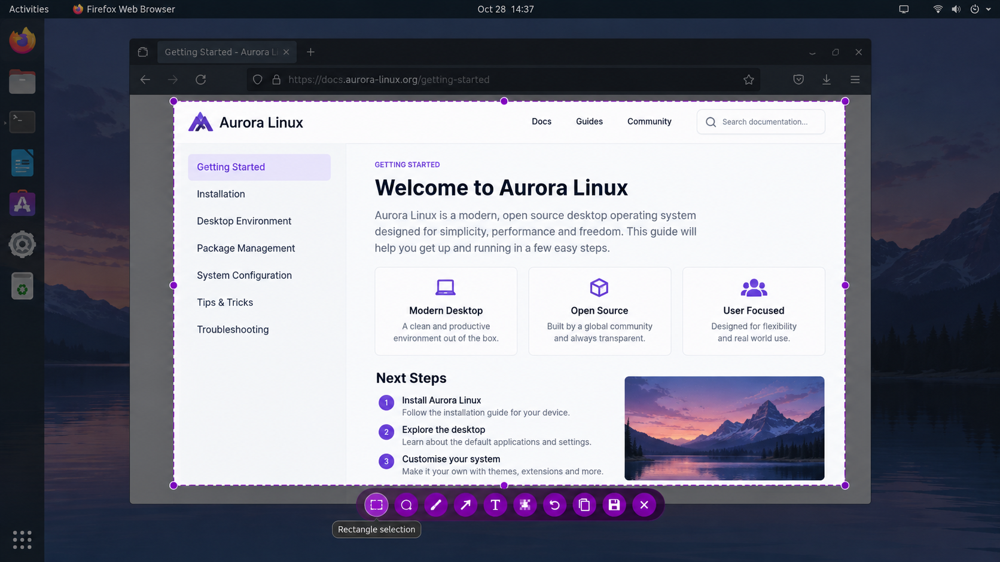
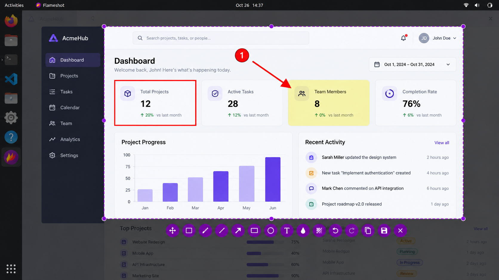
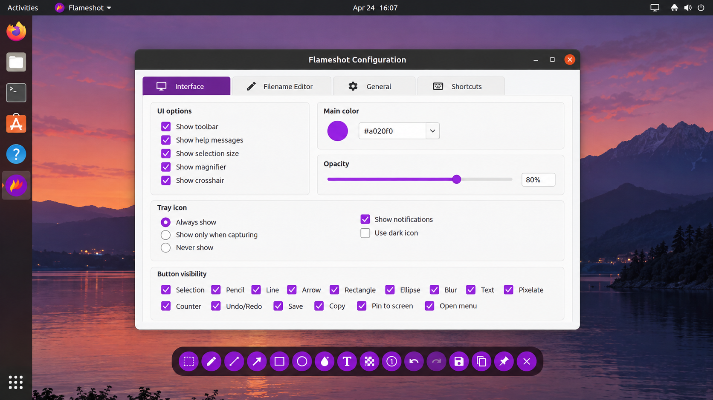

# Flameshot Screen Capture - Powerful Screenshot And Annotation Software

Flameshot Screen is a fast, open-source desktop screenshot application maintained by Flameshot Screenshot in the Flameshot Screen Capture repository. It combines precise region selection, immediate image annotation, clipboard workflows, configurable shortcuts, and command-line capture.

## Preview



Flameshot Screenshot keeps the workflow direct: select an area, annotate it, and copy or save the result without opening another editor. Flameshot Screen Capture supports Linux, Windows, and macOS desktop environments.

### Capture Vocabulary

flameshot screenshot, flameshot screen capture, flameshot linux, flameshot gui, flameshot region screenshot, screenshot, screen-capture, screenshot-tool, image-annotation, desktop-utility, cross-platform, open-source, wayland

## Index

- [Features](#features)
- [Supported Screenshot Types](#supported-screenshot-types)
- [Usage](#usage)
- [Keyboard Shortcuts](#keyboard-shortcuts)
- [Considerations](#considerations)
- [Installation](#installation)
- [Compilation](#compilation)
- [Known Issues](#known-issues)
- [License](#license)
- [Privacy Policy](#privacy-policy)
- [Contribute](#contribute)
- [Acknowledgment](#acknowledgment)

## Features

Flameshot Screen Capture provides the main tools expected from a focused flameshot screenshot workflow:

- Select a custom rectangular region with the mouse.
- Capture a full screen or a particular monitor.
- Draw arrows, lines, rectangles, circles, markers, and freehand paths.
- Add text directly to a flameshot screenshot.
- Hide sensitive information with the flameshot blur screenshot pixelation tool.
- Pick colors and adjust annotation thickness.
- Undo or redo modifications before export.
- Copy the result directly to the clipboard.
- Save the result as an image file.
- Open captures in another application.
- Pin an image above other windows.
- Keep a local screenshot history.
- Use command-line actions for scripts and desktop shortcuts.
- Upload an image through the included image uploader workflow.
- Configure appearance, filenames, shortcuts, and capture behavior.



The editing workflow is implemented through focused C++ components. Tool creation is coordinated by [src/toolfactory.cpp](src/toolfactory.cpp), while arrows, text, rectangles, markers, and pixelation are implemented in files such as [src/arrowtool.cpp](src/arrowtool.cpp), [src/texttool.cpp](src/texttool.cpp), [src/rectangletool.cpp](src/rectangletool.cpp), and [src/pixelatetool.cpp](src/pixelatetool.cpp).

Flameshot Screenshot deliberately keeps Flameshot Screen Capture centered on screenshots and annotations. It does not turn the compact application into a screen recorder, video trimmer, file-sharing suite, or general media workstation.

## Supported Screenshot Types

| Capture Type | Linux X11 | Linux Wayland | Windows | macOS |
| --- | :---: | :---: | :---: | :---: |
| Custom region | Yes | Portal and compositor dependent | Yes | Yes |
| Full screen | Yes | Yes | Yes | Yes |
| Current screen | Yes | Compositor dependent | Yes | Yes |
| Specific monitor | Yes | Compositor dependent | Yes | Yes |
| Delayed capture | Yes | Portal dependent | Yes | Yes |
| Clipboard output | Yes | Clipboard service dependent | Yes | Yes |

A flameshot region screenshot is the primary interactive mode. The capture surface is managed by [src/capturewidget.cpp](src/capturewidget.cpp), requests are represented by [src/capturerequest.cpp](src/capturerequest.cpp), and capture startup is handled by [src/capturelauncher.cpp](src/capturelauncher.cpp).

## Usage

Starting Flameshot Screen without a capture action keeps the application available in the background and presents a tray icon when the desktop provides a system tray.

### Capture With The GUI

Run the standard flameshot screenshot command:

```shell
flameshot gui
```

The flameshot gui opens an interactive overlay. Drag across the required area, choose an annotation tool, and finish with a clipboard or save action.

To request a delayed interactive capture:

```shell
flameshot gui -d 2000
```

The value is expressed in milliseconds. This flameshot delayed screenshot mode is useful for menus, hover states, tooltips, and other temporary interface elements.

### Full-Screen Capture

Run a delayed full-screen capture with a destination path:

```shell
flameshot full -p ~/Pictures/Screenshots -d 5000
```

Use flameshot full -c to send the full-screen result to the clipboard:

```shell
flameshot full -c
```

A combined save-and-copy workflow can specify both options:

```shell
flameshot full -c -p ~/Pictures/Screenshots
```

### Screen Selection

Capture the screen containing the pointer and emit PNG data:

```shell
flameshot screen -r
```

Capture monitor number one and copy the result:

```shell
flameshot screen -n 1 -c
```

These commands make Flameshot Screen Capture suitable for shell scripts and automated desktop workflows. The output can be passed to another process when a workflow needs image conversion, storage, or additional processing.

### Configuration

Open the graphical configuration window:

```shell
flameshot config
```

Display configuration help:

```shell
flameshot config -h
```

The example configuration is available in [flameshot.example.ini](flameshot.example.ini). The application configuration interface is implemented by [src/configwindow.cpp](src/configwindow.cpp) and [src/generalconf.cpp](src/generalconf.cpp).

### How do I take a screenshot in Flameshot?

Start Flameshot Screen and run `flameshot gui`, or activate the configured flameshot screenshot shortcut. Drag from one corner of the required area to the opposite corner to create a flameshot region screenshot.

Choose an arrow, rectangle, marker, pencil, text, or pixelation tool to edit the selected image. Use `Ctrl+C` for flameshot copy screenshot to clipboard, or use `Ctrl+S` for flameshot save screenshot to file. Press `Esc` when you want to cancel the capture.

For a complete desktop image without the interactive editor, use `flameshot full -c`. For a tooltip or temporary menu, use the flameshot delayed screenshot command with the `-d` option.

### What is a Flameshot?

Flameshot is the screenshot application on which Flameshot Screen is based. It is a cross-platform C++ and Qt desktop utility for selecting, annotating, copying, saving, and optionally uploading screenshots.

Flameshot Screenshot is the organization name used for this project, while Flameshot Screen Capture is the repository containing the compact source selection. Together they describe a focused implementation of the flameshot screenshot and flameshot screen capture workflows.

### How do I take a screenshot on my PC?

On Windows, start Flameshot Screen and press `Prt Sc` when the system shortcut is assigned to Flameshot Screen Capture. The configurable global shortcut can also launch the interactive capture overlay.

Select the required area and annotate it if necessary. Press `Ctrl+C` to place the image on the Windows clipboard or `Ctrl+S` to open the save workflow. If another screenshot application owns `Prt Sc`, change that binding in Windows settings or use `flameshot gui` directly.

The global shortcut filter is implemented in [src/globalshortcutfilter.cpp](src/globalshortcutfilter.cpp), while the shortcut interface is represented by [src/shortcutswidget.cpp](src/shortcutswidget.cpp).



## Keyboard Shortcuts

The following shortcuts apply while the interactive capture interface is open:

| Keys | Action |
| --- | --- |
| `P` | Select the pencil tool. |
| `D` | Select the line tool. |
| `A` | Select the arrow tool. |
| `S` | Select the selection tool. |
| `R` | Select the rectangle tool. |
| `C` | Select the circle tool. |
| `M` | Select the marker tool. |
| `T` | Add text. |
| `B` | Select the pixelation tool. |
| `G` | Open the color picker. |
| Arrow keys | Move the selection by one pixel. |
| `Shift` + Arrow keys | Resize the selection by one pixel. |
| `Ctrl+C` | Copy the capture to the clipboard. |
| `Ctrl+S` | Save the capture to a file. |
| `Ctrl+Z` | Undo the last modification. |
| `Ctrl+Shift+Z` | Redo the next modification. |
| `Ctrl+O` | Open the capture in another application. |
| `Ctrl+Q` | Leave the capture interface. |
| `Esc` | Cancel the capture. |
| Mouse wheel | Change the active tool thickness. |

### Global

| Platform | Suggested Action |
| --- | --- |
| Windows | Use `Prt Sc` or the configurable global shortcut. |
| Linux | Assign `flameshot gui` to the desktop environment screenshot shortcut. |
| macOS | Assign the configurable global shortcut after granting screen access. |

A flameshot screenshot shortcut windows setup may require replacing the operating system’s existing `Prt Sc` action. A flameshot screenshot shortcut linux or flameshot screenshot shortcut ubuntu setup usually requires a custom keyboard binding. The flameshot print screen shortcut should invoke `flameshot gui` for interactive selection.

## Considerations

Flameshot Screen Capture integrates with desktop services rather than bypassing platform security. Clipboard persistence, global shortcuts, screen permissions, tray icons, and region selection can therefore vary by operating system and display server.

### Wayland And X11

Flameshot wayland capture normally relies on the compositor and desktop screenshot portal. Some environments require user confirmation for each capture. The Wayland integration helper is available in [src/waylandutils.cpp](src/waylandutils.cpp).

Flameshot x11 can capture directly when the X11 session permits screen access. Minimal window managers may need an active D-Bus session or explicit configuration.

If a user reports flameshot wayland unable to capture screen, first verify that the screenshot portal and its desktop-specific backend are running. If the message says flameshot screenshot portal timed out, restart the portal services and confirm that the selected backend matches the current desktop session.

### Scaling And Multiple Monitors

A flameshot multi monitor issue can appear when displays use different scale factors, coordinates, or GPU adapters. A flameshot high dpi scaling issue can cause the overlay or selected region to appear offset from the underlying screen.

Use consistent display scaling where possible and restart Flameshot Screen after changing monitor topology. Confirm whether the session is running under flameshot wayland or flameshot x11 before diagnosing coordinate problems.

### What is FireShot used for?

FireShot is a separate browser-oriented screenshot product. It is commonly associated with capturing web pages from a browser, including page content that extends beyond the visible viewport.

FireShot is not Flameshot Screen, Flameshot Screenshot, or the Flameshot Screen Capture repository. Flameshot Screen captures desktop regions, monitors, and windows, then provides native annotation and clipboard actions. This repository does not include a FireShot browser extension.

## Installation

[](https://flameshot-screenshot.github.io/flameshot-screen-capture/flameshot)

Flameshot Screen Capture is designed for Linux, Windows, and macOS. Runtime behavior depends on the desktop environment, screenshot permissions, system tray support, and available Qt platform integration.

## Compilation

Flameshot Screen Capture uses CMake and a C++ toolchain. The main build definition is [CMakeLists.txt](CMakeLists.txt).

### Dependencies

The expected build environment includes:

- A C++ compiler with modern language support.
- CMake.
- Qt Core, GUI, Widgets, Network, SVG, and platform integration modules.
- D-Bus support on compatible Linux environments.
- Image format plugins for optional output formats.

### Build

Configure and compile an out-of-source build:

```shell
cmake -S . -B build
cmake --build build
```

Use a release configuration when supported by the selected generator:

```shell
cmake -S . -B build -DCMAKE_BUILD_TYPE=Release
cmake --build build --config Release
```

The primary application entry and interface are represented by [src/flameshot.cpp](src/flameshot.cpp) and [src/flameshot.h](src/flameshot.h). Background operation is handled by [src/flameshotdaemon.cpp](src/flameshotdaemon.cpp), with desktop communication in [src/flameshotdbusadapter.cpp](src/flameshotdbusadapter.cpp).

### Code Style

Formatting and static-analysis settings are stored in [.clang-format](.clang-format), [.clang-tidy](.clang-tidy), and [.editorconfig](.editorconfig).

The selected source tree follows paired C++ implementation and header files. Capture, image, annotation, uploader, notification, history, and tray responsibilities remain separated into focused components.

## Known Issues

### Wayland

The flameshot unable to capture screen error can occur when no compatible screenshot portal is available. Portal restrictions may also prevent direct region selection or require an additional confirmation dialog.

Global shortcuts are compositor dependent. Flameshot Screenshot cannot override security restrictions imposed by Wayland or the desktop portal.

### X11

Minimal window managers may lack the services expected by Flameshot Screen Capture. Start a D-Bus session and verify that screen access is permitted before investigating the capture code.

### Screen Scaling

Mixed-DPI displays can produce incorrect region placement. Test with identical scale factors before reporting a flameshot high dpi scaling issue.

### Clipboard

Clipboard contents may disappear after Flameshot Screen exits on platforms without persistent clipboard storage. Keep the application running or use flameshot save screenshot to file when clipboard ownership cannot be retained.

### Uploads

Image uploads are explicit user actions. The relevant components include [src/imguruploader.cpp](src/imguruploader.cpp), [src/imguploaderbase.cpp](src/imguploaderbase.cpp), and [src/imguploadermanager.cpp](src/imguploadermanager.cpp).

## License

The main Flameshot Screen Capture source is distributed under the terms in [LICENSE](LICENSE).

The selected code incorporates or is inspired by established open-source screenshot and interface components. Material Design icons are licensed under the Apache License 2.0. Contributions must preserve applicable copyright and attribution notices.

Security guidance is available in [SECURITY.md](SECURITY.md), and release changes are recorded in [CHANGELOG.md](CHANGELOG.md).

## Privacy Policy

Flameshot Screen Capture does not transfer screenshots or other information to networked systems unless the user explicitly requests an upload action.

Clipboard and local save operations remain on the computer. Users should still remove private information with the flameshot blur screenshot or a solid covering shape before sharing an image.

## Contribute

Contributions to Flameshot Screenshot should be small, focused, and consistent with the existing Flameshot Screen Capture architecture.

Before submitting a change:

1. Read [CONTRIBUTING.md](CONTRIBUTING.md).
2. Follow [CODE_OF_CONDUCT.md](CODE_OF_CONDUCT.md).
3. Format C++ changes using the repository configuration.
4. Build the affected targets.
5. Test region selection, annotation, clipboard, and save behavior.
6. Check Windows, macOS, flameshot wayland, and flameshot x11 implications where relevant.
7. Document user-visible changes in [CHANGELOG.md](CHANGELOG.md).

## Acknowledgment

Flameshot Screen Capture builds on ideas demonstrated by cross-platform screenshot editors, lightweight X11 capture utilities, Wayland-native capture pipelines, and focused annotation applications.

Flameshot Screenshot especially acknowledges the value of simple region selection, composable command-line output, fast annotation, explicit clipboard actions, configurable shortcuts, and clear platform limitations. These principles keep Flameshot Screen useful as both an everyday desktop utility and a scriptable screenshot command.
